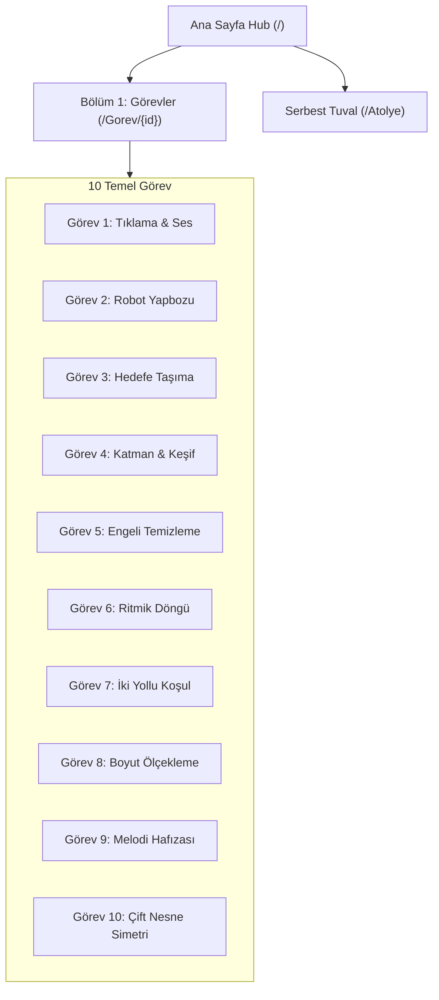

# 🚀 Ritmik Kodlar (RhythmCode) - MVP Geliştirme Planı ve Yol Haritası

> **Doküman Amacı:** Bu doküman, 7-14 yaş grubu çocuklar için tasarlanan *Ritmik Kodlar* platformunun **Minimum Uygulanabilir Ürün (MVP)** sürümünün kapsamını, mimarisini, görev detaylarını ve uygulama adımlarını belirler.

---

## 📌 1. MVP Kararları ve Kapsam Özeti

| Parametre | MVP Tasarım Kararı |
|---|---|
| **Kapsam** | **Bölüm 1'in 10 Temel Etkileşim Görevi** + **Serbest Tuval (/Atolye)** |
| **Sayfa Yapısı & Rotalar** | Ayrı MVC Sayfaları: `/` (Ana Hub), `/Gorev/1`..`/Gorev/10`, `/Atolye` |
| **Atölye Mekanizması** | Scratch benzeri dikey blok birleştirme (İleri, Dön, Renk, Döngü, Nota) + HTML5 Canvas |
| **Zorluk / Yaş Skalası** | Özel yaş filtresi yok; tüm yaşlar için sezgisel, sade ve ortak tek deneyim |
| **İlerleme / Durum (State)** | Tamamen serbest (Stateless); kilit/oturum yok, her göreve anında serbest erişim |
| **Ses Motoru** | Web Audio API Pentatonik Sentezleyici (C-D-E-G-A / Sıfır harici ses dosyası) |
| **Dil** | Türkçe (TR) |
| **Teknoloji Yığını** | ASP.NET Core MVC (.NET 10), HTML5 Canvas, Modern JavaScript, CSS3 |

---

## 🗺️ 2. Sayfa ve Rota Mimarisi

### 📍 Rotalar:
1. **`/` (HomeController -> Index):** Tüm görevlerin ve Atölye'nin listelendiği, renkli, çocuk dostu görsel karşılama alanı.
2. **`/Gorev/{id}` (GorevController -> Index):** 1 ile 10 arasındaki görevi yükler. Görev açıklaması, interaktif Canvas alanı, ses ipuçları ve sonraki/önceki görev navigasyonu içerir.
3. **`/Atolye` (AtolyeController -> Index):** Blok tabanlı serbest kodlama, çizim ve müzik atölyesi.

---

## 🎯 3. Bölüm 1: 10 Temel Görevin Şartnamesi

| # | Görev Adı | Temel Algoritmik / Bilişsel Kavram | Tuval Etkileşimi & Mekanik | İşitsel Geri Bildirim |
|---|---|---|---|---|
| **1** | **Sabit Nesne ile İlk Etkileşim** | Olay Tetikleme (`OnClick`) | Ekranda parıldayan renkli topa dokunulduğunda top zıplar ve parlar. | C4 (Do) notası + ışıltı sesi |
| **2** | **Robot Yapbozu** | Modülerlik (`Decomposition`) | Gövde, kafa ve ayakları sürükleyerek robotun yuvalarına yerleştirme. | Her parça oturduğunda artan perdeli nota, tamamlanınca neşeli akor |
| **3** | **Hedefe Taşıma ve Koordinat** | Konumlandırma (`X, Y Snap-to-Target`) | Yıldızı sürükleyip gökyüzündeki manyetik hedef yuvasına bırakma. | Taşırken kayma tonu, yuvaya kilitlenince pentatonik çan sesi |
| **4** | **Katman Algısı ve Keşif** | Derinlik Hiyerarşisi (`Z-Index`) | Öndeki yarı saydam bulut parmakla kenara çekilir, altındaki güneş gökyüzüne yerleşir. | Bulut kayarken rüzgar efekti, güneş çıkınca sıcak majör akor |
| **5** | **Engeli Temizleme & Debugging** | Hata Ayıklama (`Debugging`) | Yolu kapatan taş/bariyer dışarı fırlatılarak fırçanın yolu açılır. | Fırlatma sesi ve açılan yolda fırçanın neşeli ilerleme melodisi |
| **6** | **Ritmik Yörünge ve Sayaç** | Döngü Tekrarı (`Loop Iteration`) | Çocuk fırçayı kovalamaz; `[1x]`, `[2x]`, `[3x]` butonlarından tur sayısını seçip "Başlat" der. | Her turda ritmik perküsyon/nota çalar |
| **7** | **İki Yollu Koşullu Seçim** | Karar Mekanizması (`If-Else`) | Çalan ses ve dalga mor ise mor kapıya, sarı ışık ise sarı kapıya dokunulur. | Doğru kapıda uyumlu melodi, yanlışta merak uyandırıcı yumuşak uyarı tonu |
| **8** | **Dokunsal Boyut Ölçekleme** | Nesne Özellikleri (`Scale / Size`) | `[-]` ve `[+]` butonlarıyla fırça küçültülerek dar tünelden geçirilir. | Boyut küçüldükçe tizleşen, büyüdükçe kalınlaşan ses tonu |
| **9** | **Pentatonik Dizi Hafızası** | Sıralı Dizi Mantığı (`Array / FIFO`) | Sistem 3 notalık (örn. Do-Mi-Sol) dizi çalar; çocuk tuşlara aynı sırayla basar. | Her basışta doğru ses; dizi tamamlandığında melodik kutlama |
| **10** | **Simetrik Çift Nesne** | İlişkili Değişkenler (`Senkronizasyon`) | Birinci fırça hareket ettirildiğinde ayna ikizi ters/paralel yönde hareket ederek iki hedefi aynı anda vurur. | İki enstrümanın eşzamanlı armonik düeti |

---

## 🎨 4. Serbest Tuval / Atölye (`/Atolye`) Mimarisi

Kullanıcının sınır olmadan algoritma ve müzik üretebildiği açık uçlu yaratıcı çalışma alanı.

### 4.1. Kullanıcı Arayüzü Bileşenleri
1. **Sol Sütun (Blok Paleti):**
   - 🔵 **Hareket:** `[İleri Git (50 px)]`, `[Geri Git (50 px)]`
   - 🔄 **Dönüş:** `[Sağa Dön (45°)]`, `[Sağa Dön (90°)]`, `[Sağa Dön (120°)]`
   - 🌈 **Renk & Kalem:** `[Rengi Sarı Yap]`, `[Rengi Mavi Yap]`, `[Rengi Pembe Yap]`, `[Rengi Yeşil Yap]`
   - 🔁 **Döngü:** `[Tekrarla (2/3/4 kez)]` *(içine blok eklenebilen yuva)*
   - 🎵 **Müzik:** `[Nota Çal: Do]`, `[Nota Çal: Re]`, `[Nota Çal: Mi]`, `[Nota Çal: Sol]`, `[Nota Çal: La]`
2. **Orta Sütun (Kodlama Alanı):**
   - Blokların yukarıdan aşağıya yapboz gibi kenetlendiği çalışma alanı.
   - Blok silme / temizleme / sırayı değiştirme olanağı.
3. **Sağ Sütun (İnteraktif Çizim ve Müzik Tuvali):**
   - HTML5 Canvas (500x500 px veya dinamik duyarlı tuval).
   - Canlı fırça imleci: Yönü ve mevcut rengi gösteren sevimli fırça/kaplumbağa ikonu.
   - **"Çalıştır ▶"** Butonu: Blok dizisini yukarıdan aşağıya adım adım oynatır. Her adımda fırça hareket eder ve eşzamanlı ses çalar.
   - **"Temizle 🔄"** Butonu: Tuvali ve fırça konumunu sıfırlar.
   - **"Hız Kontrolü"**: 1x (Normal), 2x (Hızlı).

---

## 🔊 5. Web Audio API Pentatonik Ses Motoru (`audio-engine.js`)

Harici MP3/WAV indirmesi gerektirmeyen, tarayıcının yerel çipiyle gerçek zamanlı çalışan ses motoru:

- **Ölçek:** C4 Pentatonik Skala
  - **Do (C4):** 261.63 Hz
  - **Re (D4):** 293.66 Hz
  - **Mi (E4):** 329.63 Hz
  - **Sol (G4):** 392.00 Hz
  - **La (A4):** 440.00 Hz
  - **Yüksek Do (C5):** 523.25 Hz
- **Sentez Tipi:** `sine` ve `triangle` dalga osilatörleri + Exponential Decay Gain Envelopes (Ksilofon/Marimba tınısı).
- **Akustik İlke:** Hangi notalar hangi sırayla çalınırsa çalınsın pentatonik aralıklar gereği kakofoni oluşmaz; çocuk her zaman dinlendirici ve motive edici bir tını duyar.

---

## 📋 6. MVP Uygulama Aşamaları (Fazlar)

### Faz 1: Çekirdek Kütüphaneler ve Layout Hazırlığı
- [ ] `wwwroot/js/audio-engine.js`: Web Audio API pentatonik sentezleyici modülünün yazılması.
- [ ] `wwwroot/js/canvas-engine.js`: Fırça hareketi, çizim yardımcıları ve açı hesaplayıcıları.
- [ ] `Views/Shared/_Layout.cshtml`: Çocuk dostu renk teması, gezinme çubuğu ve ses denetim düğmesi.

### Faz 2: Kontrolcüler ve Rota Kurulumu
- [ ] `Controllers/HomeController.cs` & `Views/Home/Index.cshtml`: 10 Görev kartı ve Atölye giriş kartı.
- [ ] `Controllers/GorevController.cs`: `Index(int id)` eylemi ve model eşlemesi.
- [ ] `Controllers/AtolyeController.cs`: `Index()` eylemi.

### Faz 3: Bölüm 1 Görev Sayfalarının İnşası
- [ ] Görev 1..3: Etkileşim, Parça Birleştirme, Hedefe Taşıma.
- [ ] Görev 4..6: Katman (Z-Index), Engel Kaldırma, Ritmik Döngü Sayacı.
- [ ] Görev 7..10: Koşullu Seçim, Boyut Ölçekleme, Melodi Dizi Hafızası, Simetrik İkiz Nesne.

### Faz 4: Serbest Tuval / Atölye Geliştirmesi
- [ ] Blok paleti ve sürükle-bırak / tıkla-ekle komut dizisi editörü.
- [ ] Yorumlayıcı (Interpreter): Blokları sırayla okuyup fırça hareketine ve sese dönüştüren döngü.

### Faz 5: Test ve Doğrulama
- [ ] Tarayıcıda ses gecikmesi (latency) ve mobil dokunmatik etkileşim testleri.
- [ ] Tüm rotaların (`/Gorev/1` .. `/Gorev/10` ve `/Atolye`) eksiksiz çalıştığının doğrulanması.
