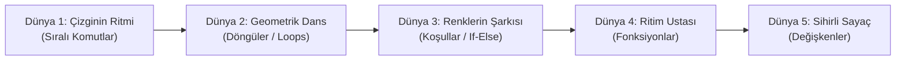

# 🎨 Ritmik Kodlar (RhythmCode): 7-14 Yaş İçin Şekil, Renk ve Müzikle Kodlama Platformu

> **Proje Amacı:** 7-14 yaş grubu çocukların yabancı dil ve ağır söz dizimi (syntax) bariyerlerine takılmadan; basit çizgisel grafikler, geometrik şekiller, canlı renkler ve uyumlu melodiler aracılığıyla algoritmik düşünce becerisi kazanmasını sağlamak. Hem masaüstünde hem de mobil cihazlarda **PWA (Progressive Web App)** olarak doğrudan yüklenebilir ve internetsiz çalışabilir.

---

## 🎯 1. Temel Tasarım ve Pedagojik İlkeler

- **Pozitif Pekiştirme & Güvenli Ortam:** Çocuklar hata yaptığında "Yandın / Kaybettin" gibi cezalandırıcı ifadeler yerine "Fırçanın kafası karıştı, adımları tekrar dinleyelim mi?" gibi merak uyandırıcı ve şefkatli geri bildirimler sunulur.
- **Düşük Bilişsel Yük (Low Cognitive Load):** Karmaşık ve dikkat dağıtıcı detaylar yerine temiz çizgiler, sade geometrik şekiller ve dinlendirici renk paletleri kullanılır.
- **İşitsel & Görsel Eşzamanlılık:** Her komut adımı hem ekranda bir çizgi/şekil oluşturur hem de **Pentatonik Skala** ile uyumlu bir melodi çalar. Yanlış bir komut dahi kulak tırmalamaz, sadece ritmi değiştirir.
- **Sıfır Bariyer (Frictionless Onboarding):** Kayıt, e-posta veya şifre zorunluluğu yoktur. Uygulamayı açan çocuk tek tıkla ilk seviyeye başlar. İlerleme yerel olarak (PWA LocalStorage / Cache) cihazda saklanır.

---

## 🧩 2. Etkileşim ve Kontrol Mekanizması

- **Klasik Dikey Blok Birleştirme (Scratch Tarzı):** 
  - Sol/alt palette yer alan komut blokları çalışma alanına sürüklenir ve birbirine yapboz gibi kenetlenir.
  - Mobilde dokunmatik ekranlara uygun, parmakla rahatça kavranabilen geniş dokunma alanları (touch targets).
- **Çift Dil Desteği (TR / EN):**
  - Tek tıkla blokların ve tüm arayüzün dili Türkçe veya İngilizceye dönüştürülebilir.
  - Örnek: `[Çizgi Çek (1 Adım)]` ↔ `[Draw Line (1 Step)]`, `[Tekrarla (3 Kez)]` ↔ `[Repeat (3 Times)]`.

---

## 🗺️ 3. Müfredat ve Dünya Yapısı (5 Dünya x 3 Görev = 15 Seviye)

### 📍 Dünya 1: Çizginin Ritmi (Sıralama - Sequencing)
*Odak: Bir hedefe ulaşmak için adımları doğru sırada dizme.*
- **Görev 1.1:** Düz bir çizgi çekerek hedefe ulaş (2 adım ileri + 2 nota çal).
- **Görev 1.2:** Dönüş yapma: İleri git, sağa dön, ileri git (L harfi çizimi + basit melodi).
- **Görev 1.3:** İki yıldızı toplayarak çizgiyi birleştir (Köşeli labirent tamamlama).

### 📍 Dünya 2: Geometrik Dans (Döngüler - Loops)
*Odak: Kendini tekrar eden kodları döngüyle kısaltma ve geometrik şekil üretme.*
- **Görev 2.1:** Kare Çiz: 4 kez (İleri git + Sağa 90° dön) döngüsüyle kare ve 4 vuruşlu ritim oluştur.
- **Görev 2.2:** Üçgen Çiz: 3 kez (İleri git + 120° dön) döngüsü.
- **Görev 2.3:** Çiçek Deseni / Çokgen: Döngü içinde döngü ile çokgen bir desen ve döngüsel melodi yakalama.

### 📍 Dünya 3: Renklerin Şarkısı (Koşullar - Conditionals)
*Odak: Karar verme mekanizmaları ve 'Eğer' mantığı.*
- **Görev 3.1:** Eğer yol sarı ise sarı renge boya, değilse maviye boya.
- **Görev 3.2:** Eğer engelle karşılaşırsan zıpla ve do diyez notası çal, yol açıksa devam et.
- **Görev 3.3:** Renk dedektifi: Farklı renkteki 3 kapıyı doğru renk koşul bloklarıyla açma.

### 📍 Dünya 4: Ritim Ustası (Fonksiyonlar / Prosedürler)
*Odak: Tekrar eden işleri tek bir yeni blok olarak isimlendirme (Fonksiyon).*
- **Görev 4.1:** Kendi "Zıpla ve Çal" bloğunu oluşturup sahneye tek blok olarak ekleme.
- **Görev 4.2:** "Yıldız Çiz" fonksiyonu oluşturup 3 farklı yere yıldız kondurma.
- **Görev 4.3:** Karmaşık bir melodiyi tek bir fonksiyona bağlayarak orkestra yönetme.

### 📍 Dünya 5: Sihirli Sayaç (Değişkenler - Variables)
*Odak: Bilgiyi hafızada tutma, artırma ve azaltma.*
- **Görev 5.1:** Puan Sayacı: Her toplanan notada sayacı 1 artır.
- **Görev 5.2:** Adım Sayacı: Çizgi uzunluğunu her döngüde birer birer artıran spiral çizimi.
- **Görev 5.3:** Final Sınavı: Belirlenen puana ulaşıldığında kapıyı açan büyük renk ve müzik şöleni.

---

## 🔊 4. İşitsel Tasarım: Web Audio API Pentatonik Sentezleyici

- **Sıfır Harici Ses Dosyası:** Tarayıcının yerel ses çipiyle (Web Audio API osilatörleri) gerçek zamanlı üretilir. PWA boyutu kilobaytlar seviyesinde kalır.
- **Pentatonik Uyum (C-D-E-G-A):** Hangi nota hangi sırayla çalınırsa çalınsın asla kakofoni veya uyumsuzluk oluşmaz; her zaman huzurlu, zen ve ksilofon/marimba benzeri tatlı bir melodi duyulur.

---

## 📱 5. PWA (Progressive Web App) Özellikleri

| Özellik | Açıklama |
|---|---|
| **Ana Ekrana Ekleme** | iOS (Safari) ve Android (Chrome) üzerinden tek tıkla "Uygulamayı Yükle" desteği. |
| **Offline First (İnternetsiz Çalışma)** | Service Worker ve Cache API sayesinde internet bağlantısı olmadan tüm bölümler eksiksiz çalışır. |
| **Responsive (Mobil Öncelikli)** | Dikey (portrait) veya yatay (landscape) telefon ve tablet tutuşlarına uyumlu adaptif düzen. |
| **Dokunmatik Optimizasyonu** | Yanlışlıkla sayfa kaydırmalarını (overscroll/pull-to-refresh) engelleyen kilitli oyun tuvali. |

---

## 🏗️ 6. Teknik Mimari ve Geliştirme Standartları

| Katman | Teknoloji / Tercih | Açıklama / Rol |
|---|---|---|
| **Sunucu & Mimari** | **ASP.NET Core MVC** (.NET 10 / Dotnet 10) | Güçlü, modern, kurumsal standartlarda MVC sunucu mimarisi. Sayfa yönlendirmeleri, PWA statik varlıklarının sunulması ve arka uç altyapısı. |
| **Konteynerizasyon** | **Docker & Docker Compose** | Geliştirme ve yayına alma (deployment) sürecinde izole, tutarlı ve taşınabilir Docker ortamı. |
| **Veritabanı (İhtiyaç Halinde)** | **PostgreSQL** | Güvenilir, açık kaynaklı ilişkisel veritabanı (seviye istatistikleri, ileride eklenebilecek kullanıcı/okul verileri için). |
| **ORM / Veri Erişimi** | **Dapper** | Yüksek performanslı mikro-ORM. Karmaşık EF Core soyutlamaları yerine hafif, hızlı ve kontrol edilebilir SQL sorguları. |
| **Frontend & Oyun Tuvali** | **HTML5 Canvas / Modern JavaScript & PWA** | Scratch benzeri dikey blok kenetleme, animasyonlu 2D çizgi/şekil motoru ve Service Worker tabanlı çevrimdışı PWA desteği. |
| **Ses Motoru** | **Web Audio API** | Pentatonik sentezleyici (harici ses dosyası indirmeden tarayıcıda dinamik ses üretimi). |
